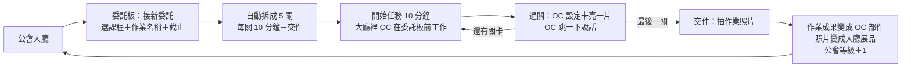

# 公會委託單（暫名）企劃表 v1.1

> 第 29 組｜數位創作與整合｜遊戲路線｜建立：2026-10-09
> 第 29 組：遊戲設計組（主筆）、互動設計組
> **給 Claude Code：先讀根目錄的 `CLAUDE.md`。第 6 節的任務卡照順序做，一次一張。**
>
> **v1.1 變更（10/9）**：① 小人沿用 AI 生成的小人，玩家第一次進入時選一隻當自己的 OC，其他的當公會成員。② 委託卡只寫學校作業，不放對照句。影響：T2、T3、T5、7.1、7.2、7.3、7.7，第 4、5、10 節。

---

## 1. 一句話

**概念句**：給為了畫角色而來、今年沒分組的大一新生，在打開平面作業、想拖到最後一晚的那一刻，用「把作業拆成 10 分鐘的公會委託、每過一關就點亮自己 OC 設定卡的一片」，讓她做基礎課作業時也覺得自己在往角色美術前進。

**做法一句話**：沿用已經做好的「OC 巡展廣場」3D demo 當公會大廳，在上面加一個核心迴圈：委託板 → 10 分鐘關卡 → OC 設定卡點亮 → 交件（作業成果變成 OC 的一部分，作業照片變成大廳展品）。

---

## 2. 為什麼做這個（證據）

| 項目 | 內容 | 出處 |
|---|---|---|
| ③ HMW（選定） | 讓為了畫角色而來的新生，做基礎課作業時也覺得自己在往角色美術前進？ | B｜L4、L12、L16、L18、L60、L62、L75、L99 |
| ④ 路線 | 遊戲。旅程圖「寫基礎課作業」是紅圈，挑證據最多的 ▲：知道要做什麼，但不想做 | B｜L12、L60、L62、L90 |
| ▲ 沒人想做的動作 | 動手做平面排版作業：簡單的當場寫完，剩下的拖到最後一晚 | B｜L60、B｜L62 |
| 她在乎的回報 | 離角色美術近一步；畫角色是她的舒壓方式 | B｜L65、B｜L99、B｜L103 |
| ● 缺的資訊 | 不知道平面課跟角色美術有什麼關係；學長姐解釋「構圖、色彩是審美的底子」後，她說「好一點點」 | B｜L18、B｜L118 |
| 一匹狼 | 看到 AI 幾秒鐘就生出細節很多的圖，會焦慮 | B｜L114 |

**Crazy 8s 採用的格子**

- 第 8 格「公會委託單」：整個遊戲的骨架（作業變委託、交件後東西出現在遊戲裡、升等）。
- 第 3 格「作業切成十分鐘小關卡」：每張委託拆成 10 分鐘一關。
- 第 7 格「OC 設定卡」：每過一關亮一片，看得見自己在前進。
- 第 5 格（字體→名牌）、第 6 格（排版→設定圖）：決定交件後作業成果變成 OC 的哪個部分。
- 第 1 格「課程對照地圖」：v1.1 決定不放，委託卡只寫學校作業。
- 不採用：第 2 格（把興趣和作業分開，方向跟 HMW 相反）；第 4 格先保留成之後的獎勵選項。

---

## 3. 核心迴圈



1. **接委託**：在委託板選課程（字體設計／色彩學／平面構成／手繪基礎）、輸入作業名稱和截止時間，系統用範本拆成 5 個 10 分鐘關卡＋1 個交件關，可以改。委託卡只寫學校作業：課程、作業名稱、截止時間、進度。
2. **開始任務**：按「開始任務（10 分鐘）」→ 計時畫面。大廳裡的 OC 走到委託板前，頭上出現進度環。
3. **過關**：時間到或提前完成 → 該關打勾 → OC 設定卡上這份作業的那一格亮起一片 → OC 跳一下、冒「完成一關！」。
4. **交件**：最後一關拍下作業照片 → 依課程變成 OC 的部件（色彩學→配色、字體設計→名牌、平面構成→設定圖版面、手繪基礎→草稿）→ 照片放上大廳展台變成展品 → 公會等級＋1。

**唯一的核心機制**：完成一個 10 分鐘關卡 → OC 設定卡亮一片。其他東西都是這個機制的舞台或結果。

---

## 4. 範圍

### 要做

| 優先 | 內容 |
|---|---|
| P0（W5 要能玩） | demo 搬進 Vite＋TS、主角 OC 與公會成員、委託板與拆關卡、10 分鐘計時、OC 設定卡點亮 |
| P1（Playtest 前） | 交件→OC 部件與展品、研究模式（事件紀錄與匯出）、部署成手機網址、自動降畫質 |
| P2（看 Playtest 回饋） | 設定圖急救小遊戲（第 6 格）、作業換畫圖時間（第 4 格）當額外獎勵 |

### 不做（課程範圍規則：一個核心機制、一個情境、不要帳號和設定頁）

- 帳號、登入、後端、多人連線、玩家之間互動
- 設定頁（研究模式除外）
- 在網頁裡即時生成 AI 圖（小人用 ComfyUI 預先生成好的圖）
- Spine、骨骼動畫、新的 3D 美術、方舟風格美術
- 推播通知、行事曆同步、成就系統、排行榜

---

## 5. 時程與分工

> 日期照 W4 的模式推估（週三上課、週日 23:59 前上傳 Notion），以老師公告為準。

| 日期 | 第 29 組遊戲設計（本週主筆） | 第 29 組互動設計 | Claude Code |
|---|---|---|---|
| 10/9（五）～10/10（六） | 紙原型：委託單卡、10 分鐘關卡卡、OC 設定卡（貼紙點亮）、交件；一起定概念句 | 主持篩選矩陣；畫 OC 設定卡版面草圖 | T0、T1、T2 |
| 10/11（日） | 自己用 dev 版走一次迴圈；填對映表；W5 內容上傳 Notion | 用紙原型做一次出聲思考：她看不看得懂設定卡跟作業的關係 | T3、T4、T5（迴圈可玩） |
| 10/12（一）～10/13（二） | 手機實測、驗收 T6～T8 | 寫 Playtest 出聲思考腳本 | T6、T7、T8（手機網址） |
| 10/14（三）W6 | 展示可玩的網址，收老師回饋 | 同左 | 修回饋 |
| 10/14～10/20 | 請 B 用一份真實作業試玩一週；每天記一次觀察（觀｜日期 時間）；最後匯出研究資料 | Playtest 結束時做出聲思考 | 依回饋決定要不要做 T9 |
| 10/21（三）W7 | 報告 Playtest 結果與版本演變 | 同左 | — |

---

## 6. Claude Code 任務卡

前置需求：Node.js 20 以上、Git。T0 開始前先確認版本。

### T0　把 demo 搬進 Vite＋TypeScript（P0）

- **目標**：畫面和互動跟 `legacy/oc_plaza_demo.html` 完全一樣，但變成可以繼續開發的專案。
- **要做**
  - 在這個資料夾初始化 Vite（vanilla-ts），保留 `CLAUDE.md`、`docs/`、`legacy/`、`public/sprites/`。
  - `three@0.170.0`、`pixi.js@8.13.2` 改用 npm 套件（跟 demo 同版本，避免 API 差異），程式裡不能再有 cdnjs 網址。
  - 把 `legacy/oc_plaza_demo.template.html` 的程式拆到 `src/scene/`（例：`renderer.ts` 共用 WebGL、`plaza.ts` 場景、`chibi.ts` 小人、`camera.ts` 鏡頭、`input.ts` 輸入）和 `src/ui/hud.ts`。Three.js 和 PixiJS 共用同一個 WebGL context 的寫法要保留。
  - 原本小人圖是 build 時塞進 `CHARS` 的 base64；改成讀 `public/sprites/manifest.json`。
  - `vite.config.ts` 的 `base` 設成 `'./'`，之後部署到子路徑才不會壞。
- **驗收**
  - [x] `npm run dev` 看到跟 legacy demo 一樣的大廳：10 隻小人會走、點小人會跳和說話、點地板會走過去、黃昏切換正常
  - [x] `npm run build` 無錯，`npm run preview` 打開正常
  - [x] 375×812 不破版
  - [x] 程式裡沒有 cdnjs 網址

### T1　狀態、儲存與事件紀錄（P0）

- **要做**
  - `src/core/types.ts`：照 7.2 的型別。
  - `src/core/state.ts`：讀寫整個 `GuildState`，帶 `version`，預留 migration。
  - `src/core/storage.ts`：用 `idb-keyval`；照片另存，key 用 `photo:<id>`，狀態裡只放 id。
  - `src/core/events.ts`：記錄 7.6 的事件。
- **驗收**
  - [x] 單元測試：建立委託、完成關卡、存檔後重新讀取，資料一致
  - [x] 重新整理頁面，資料還在
  - [x] 一般畫面沒有任何清除資料的入口（只在研究模式）

### T2　主角 OC 與公會成員（P0）

- **目標**：大廳裡有一隻「我的 OC」，其他小人變成公會成員。
- **要做**
  - 第一次進入時跳出一張卡片（不是設定頁）：輸入 OC 名字 → 從 `public/sprites/manifest.json` 的 AI 小人裡選一隻當自己的 OC，或上傳自己的圖（PNG／JPG）→ 進大廳。
  - 上傳的圖如果是白底或接近純色背景，從邊緣 flood fill 去背（容差約 24），裁掉空白，縮到高 360px 存起來。去背不乾淨也沒關係，不要接任何 AI 去背模型。
  - `public/sprites/silhouette.png` 只在圖片載入失敗時當備用。
  - 主角固定被選取（粉紅光圈）、鏡頭跟隨；可以點地板讓它走、WASD 也能走。
  - 其他小人（排除玩家選的那隻）改成公會成員：最多 6 隻，名字顯示「公會成員」，不能操控，照原本的方式閒逛、打招呼。
  - 拿掉原本底部的角色列表，改成 HUD 兩顆按鈕：「委託板」「OC 設定卡」。原本的「全員打招呼」「切換黃昏」可以留在右上。
- **驗收**
  - [x] 新使用者 3 步內進到大廳（名字 → 選一隻小人或上傳 → 進大廳）
  - [x] 白底的圖去背後放進場景，腳底對齊影子
  - [x] 重新整理後主角還是同一隻、同一張圖

### T3　委託板：接委託與拆關卡（P0）

- **要做**
  - 大廳放一個 3D 委託板（Three.js 平面＋CanvasTexture 寫「委託板」）。位置要在角色可走範圍（半徑 7.5）之外，例如後方兩座拱門之間；因為 PixiJS 畫的小人永遠在 3D 物件前面，委託板放在可走範圍裡，小人會穿幫（見 `legacy/README.md` 的已知限制）。主角工作時站在委託板正前方、可走範圍內的位置。點委託板或按 HUD「委託板」打開 overlay。
  - overlay 內容：進行中的委託列表（課程、作業名稱、截止倒數、進度 x/5）＋「接新委託」＋已完成的委託（摺疊）。
  - 接新委託：選課程 → 輸入作業名稱 → 截止日期時間 → 套 7.3 的範本產生 5 個 10 分鐘關卡＋1 個交件關。關卡可以改名、刪除、上移下移、新增。
  - 委託卡只寫學校作業：課程、作業名稱、截止倒數、進度 x/5、「開始任務（10 分鐘）」按鈕，不放其他說明文字。
- **驗收**
  - [x] 從大廳到建立好一張委託，手機上 5 次點擊以內（不含打字）
  - [x] 關卡範本都來自 `src/core/templates.ts`，改一個地方全部生效
  - [x] 過了截止時間的委託顯示「已逾期」，不會被刪掉

### T4　10 分鐘關卡（P0）

- **要做**
  - 委託卡上的「開始任務（10 分鐘）」→ 全螢幕計時 overlay：大數字倒數、暫停、提前完成、再 5 分鐘。
  - 計時用開始時間戳計算，重新整理不會歸零；瀏覽器支援的話請求 Screen Wake Lock。
  - 計時中，大廳的主角走到委託板前停下，頭上顯示進度環（PixiJS），不會自己亂走。
  - 時間到：手機支援的話震動一下，畫面問「這一關完成了嗎？」→「完成」或「再 5 分鐘」。
  - 完成：該關打勾 → 呼叫 T5 的點亮動畫 → 主角跳一下、冒「完成一關！」。
- **驗收**
  - [x] 計時中重新整理，剩餘時間正確
  - [x] 完成一關剛好點亮一片，不會重複
  - [x] 事件紀錄有 `level_started`、`level_paused`、`level_resumed`、`level_completed`

### T5　OC 設定卡（P0）

- **要做**
  - 設定卡 overlay：上方是主角圖和名字；下方 4 區（字體設計／色彩學／平面構成／手繪基礎），每區 3 格，規則見 7.4。
  - 每區標示交件後會變成什麼：字體設計→名牌、色彩學→配色、平面構成→版面、手繪基礎→草稿。
  - 點亮動畫 0.8 秒以內；顯示整張卡的完成度。
  - 還沒開始的格子寫「接一張＿＿委託來點亮」。
- **驗收**
  - [x] 進行中的委託，那一格依完成的關卡數亮起對應片數
  - [x] 點任何一片，看得到它是哪一天、哪張委託的哪一關（例：「10/12 色彩學・配色草稿」）
  - [x] 交件後那一格完整點亮並換成作業成果（T6 做完才會有內容，T5 先放佔位）

### T6　交件：作業成果變成 OC 部件和展品（P1）

- **要做**
  - 每張委託的最後一關固定是「交件」，不計時：拍照或選照片（`<input type="file" accept="image/*" capture="environment">`），長邊縮到 1024px、JPEG 品質 0.85，存 IndexedDB。
  - 依課程產生部件：
    - 色彩學：從照片抽 5 個主色（中位切割或 k-means，寫在 `src/core/palette.ts`），變成 OC 配色；設定卡的色票和主角光圈顏色跟著換。
    - 字體設計：照片裁成名牌，主角頭上的名字標籤換成這張名牌。
    - 平面構成：照片變成設定卡的「版面」縮圖。
    - 手繪基礎：照片放進設定卡的「草稿」格。
  - 作業照片變成大廳展品：後方 5 座展台依序放上相框（Three.js 平面＋照片材質），原本展台上的寶石換成相框；點相框可以放大看。超過 5 張時輪替最近的 5 張。
  - 公會等級＋1（7.5），大廳的招牌顯示等級。
- **驗收**
  - [x] 交件後重新整理，部件和展品都還在
  - [x] `palette.ts` 用 `tests/fixtures/` 的 3 張測試圖，抽出的色票穩定（測試自己準備純色塊圖即可）
  - [x] 10 張作業照片後 IndexedDB 用量小於 15MB

### T7　研究模式（P1）

- **要做**：網址加 `?research=1` 才出現的面板：事件列表、7.6 的指標、匯出 CSV（UTF-8 加 BOM，Excel 開中文才正常）和 JSON、清除全部資料（要再確認一次）。
- **驗收**
  - [ ] 匯出的 CSV 用 Excel 和 Google 試算表打開，中文正常
  - [x] 一般網址找不到研究模式的入口

### T8　部署成手機網址（P1）

- **要做**
  - 用 GitHub Pages＋GitHub Actions 自動部署（push 到 main 就更新）；README 寫網址。
  - 自動降畫質：FPS 連續 3 秒低於 40 → 關陰影、像素比降到 1。不做畫質設定頁。
  - 不支援 WebGL2 的瀏覽器顯示一句說明，不要白畫面。
- **驗收**
  - [ ] iPhone Safari 和 Android Chrome 都能打開，能完整做完一張委託
  - [ ] 手機上 FPS 30 以上
  - [x] 同一個瀏覽器關掉再開，資料還在

### T9　設定圖急救小遊戲（P2，Playtest 後再決定）

- 平面構成的加分關：把 OC 的名字、台詞、三視圖小卡拖進格線，依對齊和留白給分（第 6 格）。沒有人說要做之前不要做。

---

## 7. 規格

### 7.1 畫面清單

| 畫面 | 怎麼進去 | 主要內容 |
|---|---|---|
| 建立 OC 卡片 | 第一次進入 | 名字、選一隻 AI 小人或上傳自己的圖 |
| 公會大廳 | 首頁 | 3D 大廳、主角、公會成員、委託板、展品、HUD |
| 委託板 | 點委託板或 HUD | 進行中／已完成委託、接新委託 |
| 接新委託 | 委託板 | 課程、名稱、截止、關卡清單（可編輯） |
| 關卡計時 | 委託卡「開始任務（10 分鐘）」 | 倒數、暫停、提前完成、再 5 分鐘 |
| OC 設定卡 | HUD | 4 區 × 3 格、完成度、配色、名牌 |
| 交件 | 最後一關 | 拍照／選照片、預覽、確認 |
| 研究模式 | `?research=1` | 事件、指標、匯出、清除 |

### 7.2 資料結構

```ts
export type CourseType = 'typography' | 'color' | 'composition' | 'drawing';

export interface Level {
  id: string;
  title: string;
  minutes: number;            // 預設 10；交件關為 0
  kind: 'timed' | 'submit';
  status: 'todo' | 'doing' | 'done';
  startedAt?: number;         // 這次開始的時間戳
  pausedMs: number;           // 累計暫停
  focusMs: number;            // 實際專注時間
  doneAt?: number;
}

export interface Commission {
  id: string;
  course: CourseType;
  title: string;              // 作業名稱
  createdAt: number;
  dueAt: number;
  levels: Level[];            // 5 個 timed＋1 個 submit
  submittedAt?: number;
  photoId?: string;           // 交件照片
  cellIndex: number;          // 佔設定卡該區的第幾格（0–2，滿了往下一輪）
}

export interface OCProfile {
  name: string;
  sprite: string;             // 選的 AI 小人檔名（例：maid_1.png），或上傳圖的 id（upload:<id>）
  palette?: string[];         // 色彩學交件後的 5 個色
  nameplatePhotoId?: string;  // 字體設計
  layoutPhotoId?: string;     // 平面構成
  sketchPhotoId?: string;     // 手繪基礎
}

export interface GuildState {
  version: 1;
  createdAt: number;
  oc: OCProfile;
  commissions: Commission[];
  guildLevel: number;
  exhibits: string[];         // 展品照片 id，最近 5 張
}

export type EventType =
  | 'app_opened' | 'oc_created' | 'commission_created' | 'level_started'
  | 'level_paused' | 'level_resumed' | 'level_extended' | 'level_completed'
  | 'photo_added' | 'commission_submitted' | 'oc_card_opened' | 'exhibit_opened';

export interface LogEvent {
  t: number;
  type: EventType;
  commissionId?: string;
  levelId?: string;
  data?: Record<string, unknown>;
}
```

### 7.3 委託範本

委託卡只寫學校作業（課程、作業名稱、截止、進度），不放對照句（v1.1 決定）。

| 課程 | 預設 5 關（各 10 分鐘），第 6 關交件 | 交件後的 OC 部件 |
|---|---|---|
| 字體設計 | 讀要求圈重點／找 3 個參考字／字形草稿／描線上墨／修細節 | 名牌 |
| 色彩學 | 讀要求選主題／3 組配色草稿／上色（一）／上色（二）／檢查明度對比 | 配色 |
| 平面構成 | 讀要求列元素／3 張縮圖草稿／定網格與對齊／調行距字距／整體檢查 | 設定圖版面 |
| 手繪基礎 | 熱身線條／抓大形／修比例／明暗／細節 | 草稿 |

### 7.4 OC 設定卡規則

- 4 區（對應 4 門課）× 每區 3 格；**一格 = 一張委託**。
- 一格切成 5 片（對應 5 個 timed 關卡）。每完成一關，亮一片。
- 交件後，那一格整格點亮，並換成作業成果（色票／名牌／版面縮圖／草稿）。
- 一區 3 格都滿了，第 4 張同課程委託從第一格重新開始一輪，舊成果收進「歷史」。

### 7.5 公會等級

- 公會等級 = 1 ＋ 已交件委託數。
- 只顯示在大廳招牌和設定卡上，不做商店、不做排行榜。

### 7.6 事件與研究指標（研究模式）

每張委託計算：

| 指標 | 算法 | 對應的問題 |
|---|---|---|
| 提早開工時數 | `dueAt − 第一次 level_started` | 她是不是比最後一晚更早動手（B｜L62） |
| 最後一晚前完成比例 | 截止前 24 小時以前完成的關卡數 ÷ timed 關卡數 | 同上 |
| 每關專注時間 | `focusMs`（扣掉暫停） | 10 分鐘的長度合不合適 |
| 開工次數、暫停次數 | 事件計數 | 有沒有卡在某一關 |
| 是否交件、交件距截止 | `dueAt − submittedAt` | 迴圈有沒有走完 |
| 打開設定卡次數 | `oc_card_opened` | 她在不在乎設定卡這個回報 |

CSV 一列一個事件；JSON 給完整狀態＋事件。

### 7.7 視覺和文字

- 沿用 legacy demo 的風格：淡彩卡通 3D、圓角半透明面板、字體 Noto Sans TC／Microsoft JhengHei。
- 按鈕文字範例：「接新委託」「開始任務（10 分鐘）」「完成這一關」「再 5 分鐘」「交件」「看 OC 設定卡」。
- 主角說話範例：「完成一關！」「這份配色可以用在我身上嗎？」「交件了！」。
- 小人沿用 ComfyUI 生成的 AI 小人（`public/sprites/`）。之後要加新的 OC，用 oc-chibi-tool 生成、去背後放進 `public/sprites/`，再登記到 `manifest.json`。

### 7.8 效能和相容

- 目標：iOS Safari 16 以上、Android Chrome 110 以上；需要 WebGL2。
- 像素比上限 2；FPS 偏低時自動降畫質（T8）。
- 照片一律縮圖後才存。

---

## 8. Playtest 計畫（人做）

- **對象**：B 優先；再找 1 位處境相近的同學。
- **時間**：10/14～10/20，用一份真的平面作業。
- **開始前**：補問上一次作業什麼時候開始做、那一晚花了多久（對應補資料追問 1～3）。
- **過程中**：不提醒、不催。每天記一次觀察，格式「觀｜日期 時間」：她有沒有打開、開了哪一關。
- **結束時**：匯出研究模式資料；做出聲思考，指著設定卡問：「這一格跟你的哪份作業有關？」
- **看到這些就算有效**：
  - 第一關在截止前 24 小時以前就開始
  - 至少 3 關在最後一晚之前完成
  - 她說得出至少一格跟作業的關係

---

## 9. 對映表（紙原型 ↔ 網頁）

完整表格在 `docs/對映表.md`，功能做完由 Claude Code 更新狀態。

---

## 10. 風險與對策

| 風險 | 對策 |
|---|---|
| 3D 大廳在舊手機會卡 | 自動降畫質；真的不行就把大廳換成一張靜態圖，核心迴圈不受影響 |
| iOS 私密模式或清除網站資料會讓資料消失 | Playtest 期間每 2～3 天用研究模式匯出一次 |
| 作業照片和 OC 圖的隱私 | 只存在玩家自己的瀏覽器，不上傳 |
| B 看到 AI 圖會焦慮（B｜L114），AI 小人可能影響 Playtest | Playtest 時記下她對小人的反應（觀｜日期 時間），反應不好再討論要不要換 |
| 範圍越做越大（想加多人廣場、在網頁裡即時生成 AI 圖） | 一律寫進進度紀錄的「之後再做」，先把 Playtest 做完 |

---

## 11. 給 Claude Code 的第一句話

```
請先讀 CLAUDE.md 和 docs/企劃表.md，然後從 T0 開始。
每完成一張任務卡：跑 build 和 test，用 375×812 驗收，更新企劃表的勾勾和 docs/進度紀錄.md，
然後用繁體中文跟我回報，等我說「繼續」再做下一張。
```
